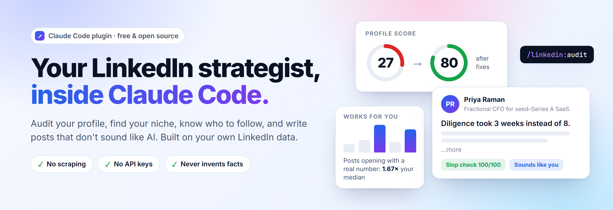
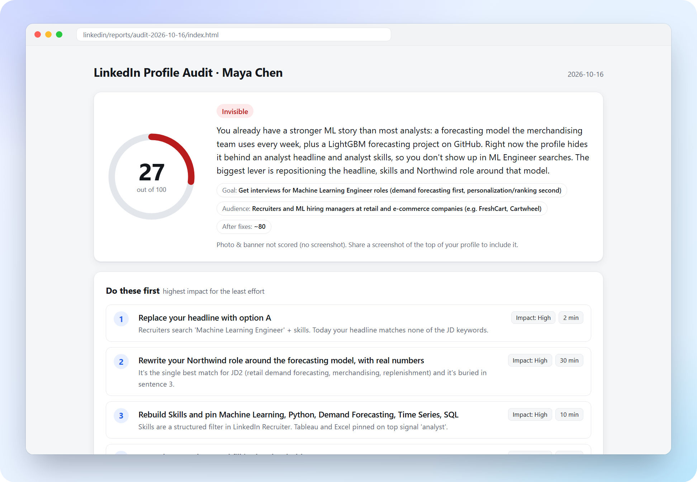
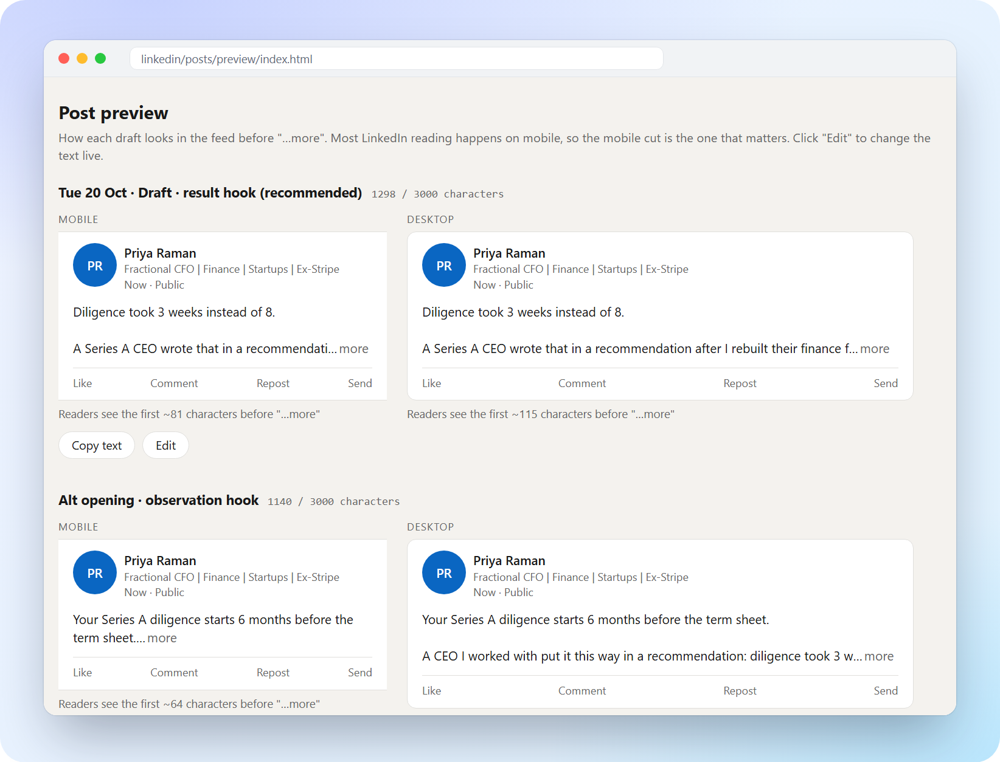
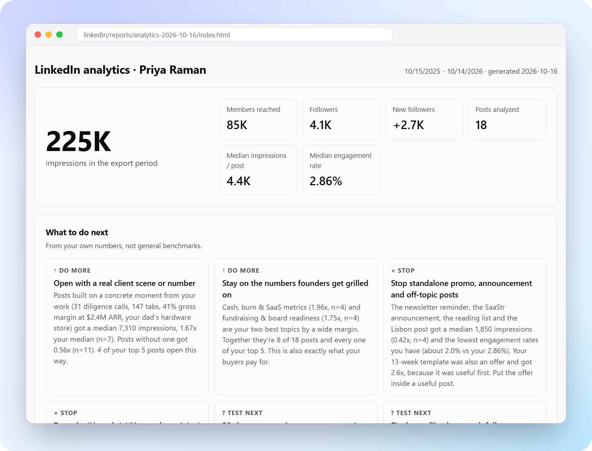
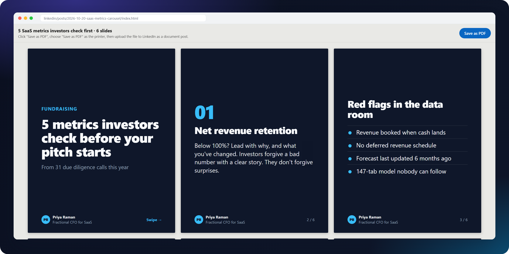
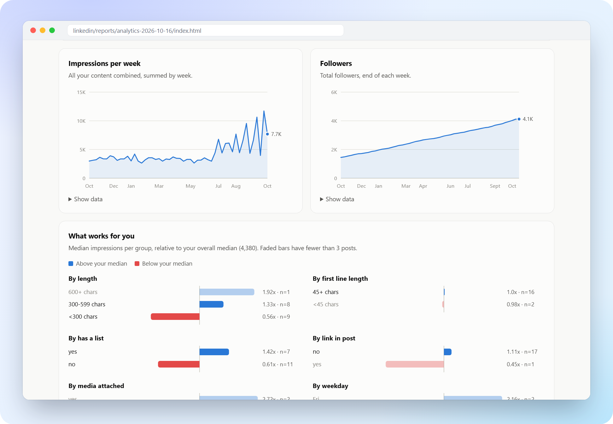
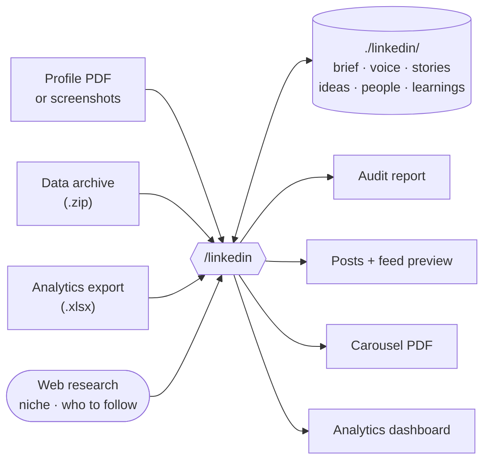

<p align="center">
  <picture>
    <source media="(prefers-color-scheme: dark)" srcset="docs/assets/hero-dark.png">
    
  </picture>
</p>

<p align="center">
  <a href="#install"></a>
  <a href="LICENSE"></a>
  
  
  
</p>

<p align="center">
  <a href="#install"><b>Install</b></a> &nbsp;·&nbsp;
  <a href="#what-you-can-do"><b>Commands</b></a> &nbsp;·&nbsp;
  <a href="#see-it-in-action"><b>Screenshots</b></a> &nbsp;·&nbsp;
  <a href="#why-its-different"><b>Why it's different</b></a> &nbsp;·&nbsp;
  <a href="#tested-head-to-head"><b>Benchmarks</b></a> &nbsp;·&nbsp;
  <a href="#faq"><b>FAQ</b></a>
</p>

<br>

<p align="center">
  
</p>

<p align="center"><sub>A real <code>/linkedin:audit</code> run, condensed. The persona is fictional; the output is what the skill produced.</sub></p>

<br>

## Install

In Claude Code, run:

```bash
/plugin marketplace add Dynode-ai/linkedin-skill
```

```bash
/plugin install linkedin@linkedin-skill
```

Then type `/linkedin` and pick a command, or just ask in plain English: *"audit my LinkedIn"*, *"who should I follow as a fintech founder?"*, *"turn this into a LinkedIn post"*.

> [!TIP]
> **Five-minute start:** make a folder (`mkdir my-linkedin && cd my-linkedin && claude`), save your profile as a PDF (your profile → **Resources** → **Save to PDF**), drop it in the folder, and run `/linkedin:start`.

<details>
<summary><b>Manual install, without the plugin system</b></summary>
<br>

```bash
git clone https://github.com/Dynode-ai/linkedin-skill
```

```bash
cp -r linkedin-skill/plugins/linkedin/skills/linkedin ~/.claude/skills/linkedin
```

Then use `/linkedin audit`, `/linkedin write ...` and so on.
</details>

**Requirements:** Claude Code on macOS, Windows or Linux. Python 3.8+ is optional; it powers the post checker and the analytics engine using only the standard library, with nothing to install. Without Python, the skill runs the same checks by hand.

<br>

## What you can do

| Command | What you get | Try saying |
|:--|:--|:--|
| **`/linkedin:start`** | A 5-minute setup that learns your goal, audience and voice, then gives you a 30-day plan | *"Help me get serious about LinkedIn"* |
| **`/linkedin:audit`** | A profile score out of 100 **for your goal**, 3 headline options, About and experience rewrites, a keyword heatmap against job descriptions, and an HTML report | *"Audit my profile, I want ML engineer interviews"* |
| **`/linkedin:niche`** | Live research into positioning options, a niche scorecard, your audience in their own words, white space and content pillars | *"What should I be known for?"* |
| **`/linkedin:follow`** | Real accounts in 4 tiers (learn from, peers, audience hubs, rising voices), each with how to engage, plus a 15-minute daily routine | *"Who should I follow to reach construction execs?"* |
| **`/linkedin:ideas`** | Post ideas built from **your** stories and what works for you, each with a drafted hook, plus an optional calendar | *"Give me a month of post ideas"* |
| **`/linkedin:write`** | Posts, carousels, hooks and comments in **your voice**, with an anti-AI-slop check and a mobile + desktop feed preview | *"Fix this draft"* · *"Interview me for a post"* |
| **`/linkedin:analyze`** | Your exports turned into personal benchmarks, audience fit and a dashboard | *"What's actually working in my content?"* |

<br>

## See it in action

Every output below is a self-contained HTML file the skill writes to your folder. They open offline and send nothing anywhere.

<p align="center">
  
  <br><sub><b>Profile audit</b>: a score for your goal, the moves that matter most, and copy-paste rewrites with live character counts.</sub>
</p>

<br>

<p align="center">
  
  
  <br><sub><b>Feed preview</b>: see exactly where "…more" cuts your hook on mobile and desktop. &nbsp;·&nbsp; <b>Analytics</b>: insights from <i>your</i> numbers, not generic benchmarks.</sub>
</p>

<br>

<p align="center">
  
  <br><sub><b>Carousel builder</b>: 1080×1350 slides that auto-fit your text. Click "Save as PDF" and upload it as a document post. No design tools or API keys.</sub>
</p>

<details>
<summary><b>More: the "what works for you" charts</b></summary>
<br>
<p align="center"></p>
</details>

<br>

## Why it's different

|  | Typical AI prompts and LinkedIn tools | This skill |
|:--|:--|:--|
| **Your data** | You paste snippets, or the tool scrapes LinkedIn and risks your account | Reads LinkedIn's **official exports**: profile PDF, data archive and analytics .xlsx. It joins your post text to your metrics. |
| **Facts** | Invents metrics and stories to sound impressive | **Never invents.** Missing facts become `[PLACEHOLDERS]` plus a question. |
| **Who to follow** | Famous names, unchecked, sometimes people who can't be found | Every link is copied from a real search result, identity is cross-checked, and the verification level is labeled |
| **Writing** | The generic "AI voice" readers scroll past | **Your** measured voice, plus a checker for 60+ AI tells, engagement bait and missing specifics |
| **Memory** | Starts from zero every time | Remembers your brief, voice, story bank and learnings in `./linkedin/` |
| **Advice** | Recycled guru myths | Evidence-tagged: LinkedIn's engineering publications and studies of 300k to 4.8M posts, with 13 myths debunked |
| **Analytics** | Generic benchmarks | Lift by topic, hook and format against **your own** median, plus whether your audience matches your buyers |
| **Price** | Paid tools run about $20 to $199 a month | Free and open source (MIT) |

<br>

## Tested head-to-head

We ran four real-world tasks twice: once with the skill, once with Claude Code alone. Same model, same prompt, same files. An independent grader checked each result against written criteria, recomputed the numbers, and spot-checked the people recommended.

| Task | With the skill | Claude alone | What made the difference |
|:--|:--:|:--:|:--|
| Audit a job seeker's profile against 2 job descriptions | **8 / 8** | 6 / 8 | Consistent scoring; no invented tools; HTML report and saved memory |
| Find people a construction-tech founder should follow | **7 / 7** | 3 / 7 | Real profile links and verification labels. Claude alone gave no links and one name that couldn't be found. |
| Analyze a LinkedIn data archive + analytics export | **8 / 8** | 6 / 8 | Every number recomputed correctly, with sample sizes and confounders, plus a dashboard |
| A month of post ideas + a ready-to-publish post | **7 / 7** | 6 / 7 | Claude alone **invented** a week-by-week client story; the skill used only real material |
| **Overall** | **100%** | **70%** | |

<sub>Synthetic personas, one run per configuration, graded October 2026. Details and caveats: <a href="tests/evals/RESULTS.md">tests/evals/RESULTS.md</a>. The skill also routed correctly on 10/10 trigger tests: it activates for LinkedIn requests and stays out of cover letters, tweets and scraping scripts.</sub>

<br>

## How it works



- **One core skill, seven commands.** Each command loads a focused workflow and only the reference files it needs.
- **Deterministic where it matters.** Character limits, the "…more" fold, AI-tell detection, export parsing and statistics are done by scripts, not guessed by the model.
- **Memory you own.** Everything the skill learns about you is plain Markdown in `./linkedin/`, so you can read and edit it.

<br>

## Get your data

All official LinkedIn features. Nothing logs in, scrapes or automates.

| Source | Where | Unlocks |
|:--|:--|:--|
| **Profile PDF** | Your profile → **Resources** → **Save to PDF** | Audit |
| **Screenshots** | The top of your profile, plus About and Featured | Photo and banner feedback |
| **Data archive** | Me → Settings & Privacy → Data privacy → **Download your data** | Your full post history, voice fingerprint, network breakdown |
| **Analytics** | Profile → Analytics → Show all → Post impressions → **Export** | Personal benchmarks, audience fit, dashboard |

<br>

## The research behind it

The skill's [algorithm notes](plugins/linkedin/skills/linkedin/references/algorithm.md) tag every claim by confidence and cite the source. A few things it will tell you:

- **Links in posts** likely cost modest reach (studies range from −19% to −36%). The "−60%" figure has no traceable source, and "put the link in the first comment" is unproven.
- **Hashtags** no longer boost reach. LinkedIn calls them "a steering wheel, not a gas pedal."
- **Story hooks** and **short first lines** get the most engagement in a 309k-post study.
- **Document carousels** are at or near the top in every dataset. Personal-profile video currently underperforms.
- **Your headline is a ranking input.** LinkedIn's 2026 feed uses author headline, company and industry, so your profile and your posts should tell the same story.

<br>

## Privacy and safety

- **Local first.** Your workspace, reports and exports stay on your computer. Nothing is uploaded except your conversation with Claude.
- **Minimal reading.** The data archive includes messages and contacts. The skill reads only what a task needs, and its network analysis is aggregate only.
- **Account-safe.** It never logs in, never scrapes, and never automates likes, comments, connections or posts.
- **Git hygiene.** If you run it inside a git repository, add `/linkedin/` to `.gitignore`.

<br>

## FAQ

<details>
<summary><b>Does it post to LinkedIn for me?</b></summary>
<br>
No, by design. Automating LinkedIn violates its User Agreement and gets accounts restricted. You copy, paste and publish, which takes 10 seconds.
</details>

<details>
<summary><b>Is it against LinkedIn's terms?</b></summary>
<br>
No. It only uses LinkedIn's own export features and text you paste. It never logs in, scrapes or automates.
</details>

<details>
<summary><b>Will my posts sound like ChatGPT?</b></summary>
<br>
That's the main failure it's built to prevent. Give it a few samples of your writing, or your data archive, and it writes to your measured style. Then every draft goes through the slop checker. LinkedIn added a "Seems like AI slop" report option in July 2026, so this matters.
</details>

<details>
<summary><b>How is the profile score calculated?</b></summary>
<br>
With a transparent rubric: 10 categories and 100 points, weighted for your goal. It's defined in <a href="plugins/linkedin/skills/linkedin/workflows/audit.md"><code>workflows/audit.md</code></a>. It's this skill's rubric, not a LinkedIn metric, and it's designed to be consistent so you can track progress.
</details>

<details>
<summary><b>What does it cost to run?</b></summary>
<br>
The skill is free. It uses your normal Claude Code usage. In testing, a typical command used roughly 1.5 to 2 times the tokens of asking Claude directly, in exchange for verified research, saved memory and the visual reports.
</details>

<details>
<summary><b>Can I use it with Claude.ai or other agents?</b></summary>
<br>
Claude Code is the primary target. The core <code>linkedin</code> folder follows the open Agent Skills format, so it can be uploaded to Claude.ai or used by other SKILL.md-compatible agents, but that's experimental. The slash commands and the file workspace work best in Claude Code.
</details>

<details>
<summary><b>What's in the repo?</b></summary>
<br>

```
plugins/linkedin/skills/
  linkedin/            core skill: SKILL.md, workflows/, references/, scripts/, assets/
    scripts/check.py           post and profile checker (AI tells, the fold, limits)
    scripts/linkedin_data.py   export parser, benchmarks, voice fingerprint, dashboard
    assets/                    audit report · feed preview · carousel · dashboard · templates
  start/ audit/ niche/ ideas/ write/ follow/ analyze/    the slash commands
tests/                 synthetic fixtures, regression tests, eval prompts and results
```
</details>

<br>

## Contributing

Issues and pull requests are welcome, especially:

- **Export files the parser doesn't understand.** Run `python3 linkedin_data.py inspect <file>` and share the output, never your data.
- **New evidence on how LinkedIn works**, with sources.
- **AI-tell patterns** the checker misses.

Run the tests with `python tests/make_fixtures.py` and then `python -m unittest discover tests`. See [`tests/README.md`](tests/README.md).

<br>

<p align="center">
  <sub>MIT © <a href="https://github.com/Dynode-ai">Dynode.ai</a> · Not affiliated with or endorsed by LinkedIn Corporation. LinkedIn is a trademark of LinkedIn Corporation.</sub>
</p>
